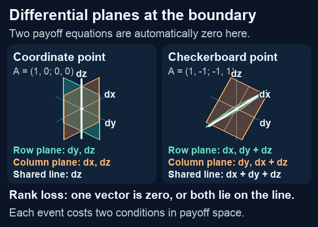

# Smoothness of Nash CI surfaces for two disjoint edges

Is the Nash conditional-independence variety a smooth complex projective surface for binary games with two disjoint edges and any number of isolated players?

**Result.** Yes, for generic payoff tables. The smoothness holds at every point of the complex closure, including points where tensor coordinates or total mass vanish.

[Paper PDF](paper/manuscript.pdf) · [LaTeX source](paper/manuscript.tex) · [Catalog Q220](https://github.com/10m-u/open-problems-catalog/blob/ca8d4d44ba3db527f19f28928c240168f545ecfe/problems/game_theory/noncooperative-games-equilibrium-theory.md#q220) · [Sendra-Arranz's thesis, §3.6](https://tobias-lib.ub.uni-tuebingen.de/xmlui/bitstream/handle/10900/160061/Thesis.pdf?isAllowed=y&sequence=1)

## Where two payoff equations vanish automatically

At either illustrated boundary point, a row equation and a column equation vanish for every payoff choice. Their first derivatives vary independently in two distinct planes within a three-dimensional cotangent space. The two derivatives lose rank if one is zero or if both lie on the shared line. Each event imposes two conditions in the four-dimensional space of derivative pairs.

[Download the offline explorer ZIP](https://raw.githubusercontent.com/DannyExperiments/smooth-nash-ci-surfaces/v1.0.0/visualization/smooth-nash-ci-surfaces-explorer.zip) · [Worked examples and rendering guide](visualization/README.md)

## Proof idea

In each edge factor, each paired player's equation vanishes along three fixed lines for every payoff table. The proof separates these line strata, their intersection points and the complement. On a product stratum, the equations that vary in value have independent tangent derivatives for generic payoffs. The base players supply normal derivatives. Their rank-loss loci impose more conditions than the dimension available in the generic fiber, so the combined Jacobian has full rank at every solution.

The equations, generic irreducibility and nonemptiness are known from earlier work. The closest smoothness theorem excludes the tensor-coordinate and total-mass hyperplanes. The new argument covers the full complex projective surface for this binary two-edge family. [Prior work and exact scope](audits/public_safe_reports/LITERATURE_AUDIT.md)

## Replay and review

The replay independently enumerates projective base strata and local derivative ranks over three small finite fields. The paper proves the theorem over the complex numbers. [Reproduce the checks](REPRODUCIBILITY.md) · [Review status](STATUS.md) · [Claim scope](CLAIM_SCOPE_AND_LIMITATIONS.md)

DannyExperiments is the preferred citation identity. [Citation metadata](CITATION.cff) · [Research disclosure](AI_DISCLOSURE.md)

[Release v1.0.0](https://github.com/DannyExperiments/smooth-nash-ci-surfaces/releases/tag/v1.0.0) · [Version DOI](https://doi.org/10.5281/zenodo.24569556)

## Partial Lean verification

For a two-by-two edge matrix over any field, the independent payoff equations identify all three row-base lines. Their intersections with the column-base lines consist precisely of the four coordinate axes and the checkerboard line in the affine cone. Generic smoothness, transversality, the remaining strata and the projective nonemptiness argument are in the manuscript. [Formal statement and replay](formal/closing/README.md)
